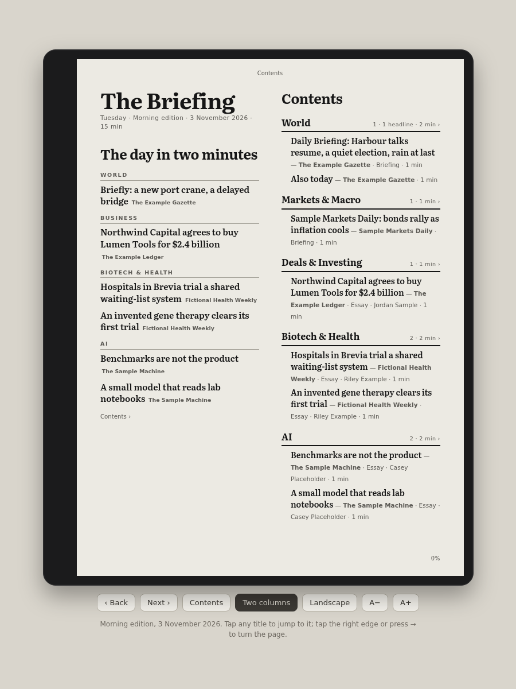
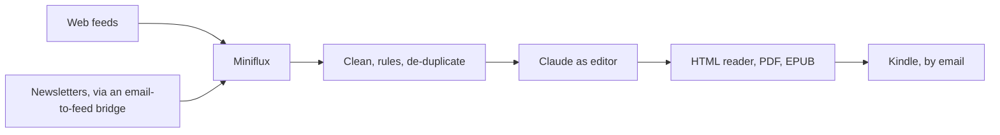
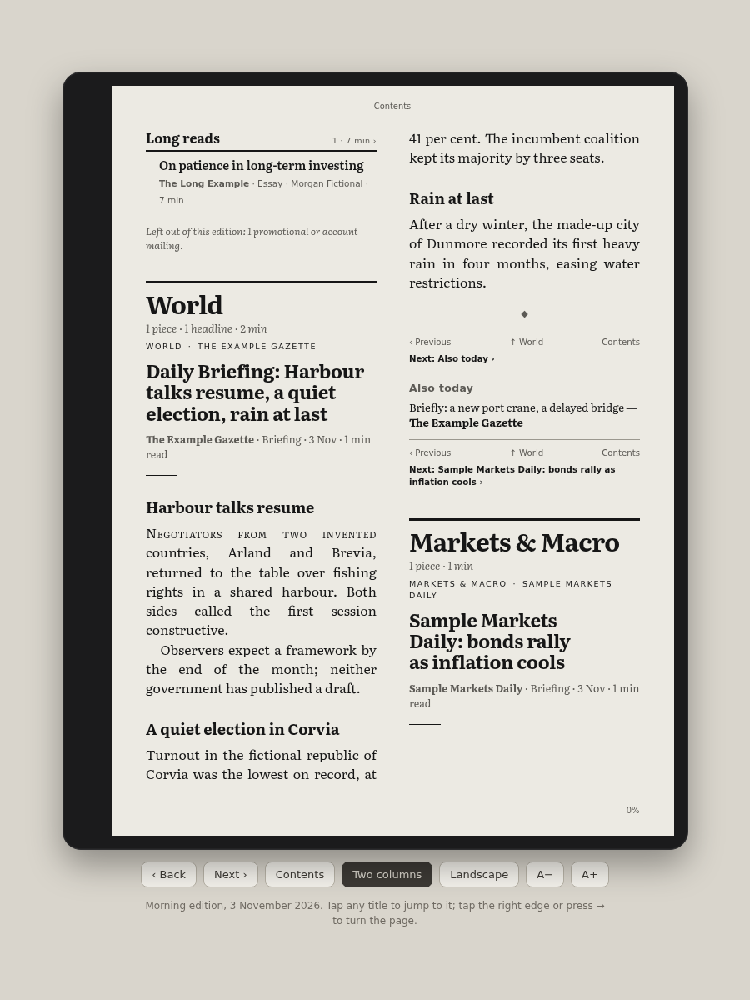

# The Briefing

A personal newspaper, built twice a day from my feeds and newsletters, with Claude as its editor.

> **Public mirror.** This is a sanitised snapshot of code from a private repository I run in production. Secrets, personal data, infrastructure details and the modules that read paywalled sites through my own logged-in sessions are removed. It passes a leak check (a private-string denylist and gitleaks) before it is published. Development happens in the private repository, so this copy takes no pull requests. Snapshot taken 3 November 2026.

This is a single-commit snapshot: the private history (46 pull requests between 12 October and 1 November 2026) is not published.



## Why it exists

I follow dozens of newsletters and feeds across finance, biotech, health policy and AI. In an inbox they arrive as a stream of duplicates, promotions and tracking links. The Briefing turns them into one edition in the morning and one at midday, laid out like a newspaper: the same story once, the important pieces in full, everything else as a one-line headline, and a copy on my Kindle to read away from a screen.

## How it works



1. **Read.** `miniflux.py` reads every entry stored since the last edition from a [Miniflux](https://miniflux.app) reader, read-only. Newsletters reach Miniflux as Atom feeds through an email-to-feed bridge (any such service works; mine is not included). A few public feeds are read directly.
2. **Clean.** `clean.py` and `briefing.prep` reduce each newsletter to its text: no tracking pixels, sponsor blocks, footers or "view in browser" lines. Admin and promotional mail is dropped and counted.
3. **File.** `rules.py` holds the editorial rules in one place: five themes (World, Markets & Macro, Deals & Investing, Biotech & Health, AI) plus Long reads, which newsletter anchors each theme, which publications are briefings, roundups or essays, and what counts as the same story. `headlines.py` pulls headlines out of roundup newsletters and points each link at its article rather than a tracker.
4. **Edit.** The `claude` CLI runs as the editor with no tools and none of the job's credentials, because the newsletters are untrusted text. It scores each piece against a short reader profile, picks three Must reads and the articles to print in full, writes a two-sentence "In short" on long pieces, and groups the same story told twice. Every reply is checked defensively: an unknown id is ignored, and a summary that states a figure the piece does not contain is dropped. If the model fails, the edition still builds without it.
5. **Remember.** Each edition leaves a small record, so the next one does not repeat a story, and the Sunday morning edition opens with the week's best pieces and key market moves.
6. **Render.** `briefing.render` lays out one self-contained HTML reader (paged like an e-reader, with a front page, "The day in two minutes", and a two-level Contents), then a PDF through headless Chromium and a reflowable EPUB through pandoc, reshaped so Kindle's converter keeps the navigation.
7. **Deliver.** The EPUB is emailed to a Kindle through the [Resend](https://resend.com) API, once per edition, with retries and an idempotency key. A failed send never costs the edition; it is noted on the next one.



## What is left out of this copy, and why

- **Paywall readers.** The private version reads a few subscribed publications in full through my own signed-in browser sessions. That module is removed. `briefing/fulltext_hook.py` keeps its contract as a documented plug-in point that returns nothing, so every edition here is built from the feeds and newsletters alone.
- **Inbox and social readers.** Sections built from my email inboxes, from X, and from my job search are removed, along with their tests.
- **Host deployment.** The private repository installs the job on a home server, injects credentials from a secrets manager and publishes editions behind a private network. Those parts are replaced by environment variables (`.env.example`) and a generic systemd unit and timer in `deploy/`.

## Run it locally

You need Python 3.12 or later, a Miniflux instance with an API token, the [`claude` CLI](https://docs.anthropic.com/en/docs/claude-code) with an Anthropic API key, and optionally pandoc and Chromium for the EPUB and PDF.

```bash
python3 -m venv .venv && .venv/bin/pip install -r requirements.txt
cp .env.example .env               # fill in your Miniflux address and token, and your Anthropic key
cp interests.example.md interests.md
set -a; . ./.env; set +a
.venv/bin/python briefing/briefing.py --since-hours 24 --dry-run
```

A dry run writes the edition into the state folder and records nothing. Without `--dry-run` it writes to `editions/<date>-<am|midday>/` and, when `BRIEFING_KINDLE_TO` is set, mails the EPUB.

To see an edition with no accounts at all, build one from the synthetic fixture (every publication, person and figure in it is invented):

```bash
python3 tests/test_smoke.py --keep sample
```

## Tests

```bash
tests/run.sh
```

Four test scripts are carried over from the private repository (cleaning and rules, the front page, headlines and links, the Miniflux reader, the EPUB structure, cross-edition memory and Kindle delivery with the HTTP call mocked), with the checks for the removed sections taken out. `tests/test_smoke.py` builds a whole edition from synthetic entries with no network and no model.

## How it was built

I am a physician-scientist, not a software engineer. I build by directing AI coding agents: I decide what to build and how it should behave, set the controls, and verify the result in the editions I read; the agents, mainly Claude Code, write the code. Every change went through a pull request; the repository gates merges on a required CI check and runs an automated Claude review on each pull request. Many rules in the code carry a dated comment recording the editorial decision behind them. In the private repository, scheduled jobs are moving to signed container images pinned by digest; the Briefing still runs from a systemd timer on a home server and is due to move.

## Licence

MIT. See `LICENSE`.
